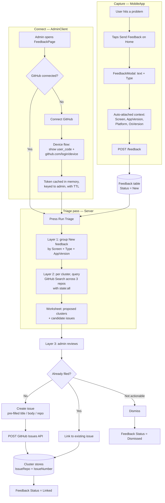

# Feedback & Issue Triage Pipeline

This document specifies the in-app feedback feature and the admin-driven triage pipeline that
turns raw user feedback into GitHub issues.

## Table of Contents

- [Overview](#overview)
- [Goals and Non-Goals](#goals-and-non-goals)
- [Scope: Phase 1](#scope-phase-1)
- [Workflow Diagram](#workflow-diagram)
- [Data Model](#data-model)
- [Where Everything Lives](#where-everything-lives)
- [API Surface](#api-surface)
- [GitHub Authentication: Device Flow](#github-authentication-device-flow)
- [The Triage Pass](#the-triage-pass)
- [Build Plan](#build-plan)
- [Prerequisites](#prerequisites)
- [Future: Automated Suggestion](#future-automated-suggestion)
- [Open Questions](#open-questions)

---

## Overview

Two sources feed one backlog:

1. **In-app feedback** submitted by users from MobileApp.
2. **GitHub Issues** across the three active repositories.

The pipeline closes the gap between them. An admin opens AdminClient, presses **Run Triage**, and
gets a pre-filled worksheet: feedback grouped into likely duplicates, each group paired with
candidate GitHub issues that may already cover it. The admin confirms, then links each group to an
existing issue or creates a new one.

The admin is the decision-maker. The pipeline's job is to make that decision fast, not to make it
automatically.

### Active repositories

| Repository | Role | Default branch |
|------------|------|----------------|
| `jbaca0/WorkoutTracker.Server` | Backend API, data, GitHub integration | `master` |
| `jbaca0/WorkoutTracker.MobileApp` | React Native app, feedback capture | `main` |
| `jbaca0/WorkoutTracker.AdminClient` | Admin web app, triage UI | `main` |

`WorkoutTracker.Client` is **deprecated**, superseded by MobileApp. It is excluded from triage and
should be archived on GitHub.

---

## Goals and Non-Goals

### Goals

- Capture user feedback with enough structured context to be actionable without a follow-up.
- Never file the same bug twice.
- Recognise when feedback describes an already-closed issue (regression, or a user on a stale build).
- Keep the issue-creation decision behind an explicit human action.
- Store no long-lived GitHub credential anywhere.

### Non-Goals (Phase 1)

- No automatic issue creation on feedback submission.
- No LLM or embedding model. See [Future](#future-automated-suggestion).
- No unattended/scheduled triage. Triage is triggered by a button press.
- No cross-repo coordinated PRs. One cluster maps to one issue in one repo.

---

## Scope: Phase 1

Three layers of matching, cheapest first:

| Layer | Mechanism | Cost |
|-------|-----------|------|
| **1. Structured grouping** | Group untriaged feedback by `Screen` + `Type` + major `AppVersion` | Free, a `GROUP BY` |
| **2. Issue candidate search** | GitHub Search API per cluster, `state:all` across the 3 repos | Free, uses the device-flow token |
| **3. Human review** | Triage UI: confirm/split/merge clusters, link or create | A few minutes per batch |

Layer 2 will not match *"why is the target box empty"* to
*"Target column collapses when an exercise has no previous data"* — users describe symptoms,
issue titles describe causes, and keyword search does not bridge that. Layer 3 exists because a
human bridges it instantly. This is a deliberate trade: at current volume, automating it costs more
complexity than the minutes it saves.

---

## Workflow Diagram



---

## Data Model

### `Feedback`

| Field | Type | Notes |
|-------|------|-------|
| `Id` | `Guid` | PK |
| `UserId` | `Guid` | Identity user who submitted |
| `Body` | `string` | User text, required, max 2000 |
| `Type` | `FeedbackType` | `Bug` \| `Idea` \| `Other` — user-selected |
| `Screen` | `string?` | Route path, from `usePathname()` |
| `AppVersion` | `string?` | From `Constants.expoConfig.version` |
| `Platform` | `string?` | `ios` \| `android` |
| `OsVersion` | `string?` | |
| `ContextJson` | `string?` | JSON blob: active workout id, recent actions |
| `CreatedAt` | `DateTime` | UTC |
| `Status` | `FeedbackStatus` | `New` \| `Clustered` \| `Linked` \| `Dismissed` |
| `ClusterId` | `Guid?` | FK to `FeedbackCluster`, null until grouped — **added in Phase 2** with the cluster table |
| `DismissReason` | `string?` | |

### `FeedbackCluster`

| Field | Type | Notes |
|-------|------|-------|
| `Id` | `Guid` | PK |
| `Title` | `string` | Human-editable; becomes the issue title |
| `Summary` | `string?` | Human-editable; becomes part of the issue body |
| `SuggestedRepo` | `string?` | Proposed target repo |
| `IssueRepo` | `string?` | Null until an issue exists |
| `IssueNumber` | `int?` | Null until an issue exists |
| `CreatedAt` | `DateTime` | |
| `UpdatedAt` | `DateTime` | |

### Notes

- **A cluster of one is normal.** All linked feedback goes through a cluster, so there is a single
  path to an issue regardless of how many reports back it.
- **`(IssueRepo, IssueNumber)` is the idempotency key.** Re-running triage must never re-create an
  issue for a cluster that already has these set. Do not rely on GitHub Search for this — its index
  lags behind issue creation by up to a minute, so a re-run immediately after creating an issue can
  miss it. The local column is authoritative.
- **Clusters must be splittable and mergeable in the UI.** Layer 1 grouping will occasionally lump
  two unrelated bugs from the same screen together. Without a split action you will be editing the
  database by hand.
- `Screen` and `AppVersion` carry more dedup signal than the prose does. Capture them from day one
  even if `ContextJson` lands later.

---

## Where Everything Lives

### `WorkoutTracker.Server`

```
Enums/
  FeedbackType.cs                       NEW   Bug | Idea | Other
  FeedbackStatus.cs                     NEW   New | Clustered | Linked | Dismissed
Models/
  Feedback.cs                           NEW   EF entity
  FeedbackCluster.cs                    NEW   EF entity
  ApplicationDbContext.cs               EDIT  +2 DbSet, + OnModelCreating config
  Repositories/
    FeedbackRepository.cs               NEW   queries, grouping
    RespositoryService.cs               EDIT  + AddScoped<FeedbackRepository>()
DomainObjects/
  Feedback.cs                           NEW   FromModel / ToModel / FromData / ToData
  FeedbackCluster.cs                    NEW
DataTransferObjects/
  Common/
    Feedback.cs                         NEW
    FeedbackCluster.cs                  NEW
    IssueCandidate.cs                   NEW   repo, number, title, state, score
  Requests/Feedback/
    SubmitFeedbackRequest.cs            NEW
    CreateClusterRequest.cs             NEW
    UpdateClusterRequest.cs             NEW
    LinkIssueRequest.cs                 NEW
    CreateIssueRequest.cs               NEW
  Responses/Feedback/
    FeedbackListResponse.cs             NEW
    TriageWorksheetResponse.cs          NEW
    GitHubAuthStatusResponse.cs         NEW
    DeviceCodeResponse.cs               NEW
Handlers/
  FeedbackHandler.cs                    NEW   user submit, admin list
  FeedbackTriageHandler.cs              NEW   triage pass, cluster CRUD, link, create
  GitHubAuthHandler.cs                  NEW   device flow start / poll / status / disconnect
Services/
  GitHubService.cs                      NEW   HttpClient: issue search, issue create
  GitHubTokenStore.cs                   NEW   IMemoryCache wrapper, TTL, per-admin key
  FeedbackClusteringService.cs          NEW   Layer 1 grouping + keyword extraction
Routes/
  FeedbackRoutes.cs                     NEW   /feedback, /admin/feedback/*, /admin/github/*
Migrations/
  <timestamp>_AddFeedback.cs            NEW   generated
Program.cs                              EDIT  + AddMemoryCache, AddHttpClient, MapFeedbackRoutes
WorkoutTracker.Server.Tests/
  Handlers/FeedbackHandlerTests.cs      NEW
  Handlers/FeedbackTriageHandlerTests.cs NEW
  Services/FeedbackClusteringServiceTests.cs NEW
  Repositories/FeedbackRepositoryTests.cs NEW
```

`AddMemoryCache()` and `AddHttpClient()` are **not currently registered** in `Program.cs`, and
there is no existing `HttpClient` usage anywhere in Server — `GitHubService` is the first outbound
integration.

### `WorkoutTracker.MobileApp`

```
src/DataTransferObjects/
  Feedback.ts                           NEW
  SubmitFeedbackRequest.ts              NEW
src/Domain/
  Feedback.ts                           NEW   FromData / ToData
src/Enums/
  FeedbackType.ts                       NEW
src/Services/
  FeedbackService.ts                    NEW   extends BaseService
src/Components/
  FeedbackModal.tsx                     NEW   built on existing FullScreenModal.tsx
src/Utils/
  deviceContext.ts                      NEW   version, platform, OS, current route
app/(tabs)/home.tsx                     EDIT  + Send Feedback entry near the Log Out button
src/__tests__/
  FeedbackService.test.ts               NEW
  Feedback.test.ts                      NEW
  FeedbackModal.test.tsx                NEW
```

Context sources: `Constants.expoConfig?.version` (expo-constants 18.0.13, already a dependency),
`Platform.OS` / `Platform.Version` from react-native, and `usePathname()` from expo-router for
`Screen`.

There is no Settings screen in MobileApp — the tab bar holds exercises, home, history, plans. The
entry point goes on the Home screen beside Log Out rather than adding a fifth tab.

### `WorkoutTracker.AdminClient`

```
src/DataTransferObjects/
  Common/Feedback.ts                    NEW
  Common/FeedbackCluster.ts             NEW
  Common/IssueCandidate.ts              NEW
  Requests/CreateClusterRequest.ts      NEW
  Requests/LinkIssueRequest.ts          NEW
  Requests/CreateIssueRequest.ts        NEW
  Responses/TriageWorksheetResponse.ts  NEW
  Responses/GitHubAuthStatusResponse.ts NEW
src/Domain/
  Feedback.ts                           NEW
  FeedbackCluster.ts                    NEW
src/Enums/
  FeedbackType.ts                       NEW
  FeedbackStatus.ts                     NEW
src/Services/
  FeedbackService.ts                    NEW   extends BaseService
  GitHubAuthService.ts                  NEW   device flow calls
src/Hooks/
  useGitHubAuth.tsx                     NEW   connection state + polling
src/Pages/FeedbackPage/
  FeedbackPage.tsx                      NEW   (no .module.css — AdminClient styles with MUI)
src/Components/FeedbackTriage/
  ClusterCard.tsx                       NEW   a cluster + its members
  IssueCandidateList.tsx                NEW   Layer 2 results, link action
  CreateIssueDialog.tsx                 NEW   pre-filled title / body / repo
  GitHubConnectDialog.tsx               NEW   device code + verification link
src/App.tsx                             EDIT  + /feedback route
src/Components/AppLayout/AppLayout.tsx  EDIT  + Feedback nav button
```

AdminClient currently has **no test runner** (only `lint`). Since it is becoming the control plane
for this pipeline, adding Vitest is part of the build plan.

### Cross-repo

```
Docs/FEEDBACK_PIPELINE.md               THIS FILE
Docs/API_REFERENCE.md                   EDIT  + feedback endpoints
Docs/ARCHITECTURE.md                    EDIT  + pipeline section, drop Client
Docs/FRONTEND_REFERENCE.md              EDIT  + FeedbackPage, FeedbackModal
```

> **Note:** `Docs/` sits at `/Users/jacob/Projects/WorkoutTracker/Docs/`, above all four git
> repositories, so **it is not version controlled by any of them**. That is the existing convention
> for this folder, but it means this spec exists only on your machine. Worth deciding whether Docs/
> should move into the Server repo or get a repo of its own.

---

## API Surface

### User-facing (any authenticated user)

| Method | Route | Purpose |
|--------|-------|---------|
| `POST` | `/feedback` | Submit feedback with context |

Rate limited to `FeedbackHandler.RateLimitCount` submissions per user per
`FeedbackHandler.RateLimitWindow` (10 per hour), returning `429` beyond that. The endpoint takes
free text from any authenticated user, so it needs a guard. Note that `fetchFromServer` surfaces
every non-2xx as a generic `Error`, so the app currently shows one message for all failures
rather than calling out the rate limit specifically.

### Admin-facing (`/admin` group, `AdminOnly` policy)

| Method | Route | Purpose |
|--------|-------|---------|
| `GET` | `/admin/feedback` | List feedback, filter by `status` |
| `POST` | `/admin/feedback/triage` | Run the triage pass, return worksheet |
| `POST` | `/admin/feedback/clusters` | Create a cluster from feedback ids |
| `PUT` | `/admin/feedback/clusters/{id}` | Edit title / summary / target repo |
| `POST` | `/admin/feedback/clusters/{id}/members` | Add feedback to a cluster |
| `DELETE` | `/admin/feedback/clusters/{id}/members/{feedbackId}` | Remove from cluster (split) |
| `POST` | `/admin/feedback/clusters/{id}/link` | Link cluster to an existing issue |
| `POST` | `/admin/feedback/clusters/{id}/issue` | Create a GitHub issue from the cluster |
| `POST` | `/admin/feedback/{id}/dismiss` | Dismiss with a reason |
| `GET` | `/admin/feedback/issues/search` | Proxy GitHub issue search (`q`, `repo`) |

### GitHub auth (`AdminOnly`)

| Method | Route | Purpose |
|--------|-------|---------|
| `POST` | `/admin/github/device/start` | Begin device flow; returns `user_code`, `verification_uri` |
| `POST` | `/admin/github/device/poll` | Poll for the access token |
| `GET` | `/admin/github/status` | Connected? expires when? |
| `POST` | `/admin/github/disconnect` | Drop the cached token |

The existing `/admin` group in `Routes/AdminRoutes.cs` already applies
`.RequireAuthorization("AdminOnly")`; the new routes follow the same pattern in their own
`FeedbackRoutes.cs`.

---

## GitHub Authentication: Device Flow

Chosen because it requires **no client secret** — only a Client ID, which is public by design.

### Setup (one-time, manual)

1. Register a GitHub App (or OAuth App) under the `jbaca0` account.
2. Tick **Enable Device Flow** in its settings.
3. Grant `issues: write` and `metadata: read` on the three active repositories.
4. Put the **Client ID** in Azure App Service configuration as `GitHub__ClientId`.

A GitHub App is preferred over an OAuth App: its user tokens expire (8 hours, refreshable), where
OAuth App tokens never expire on their own.

### Runtime flow

1. Admin clicks **Connect GitHub** in AdminClient.
2. Server `POST`s `https://github.com/login/device/code` with the Client ID and scope.
3. Server returns `user_code` and `verification_uri` to AdminClient, which displays both.
4. Admin visits `github.com/login/device`, enters the code, approves.
5. Server polls `https://github.com/login/oauth/access_token` with
   `grant_type=urn:ietf:params:oauth:grant-type:device_code`, respecting the returned `interval`.
6. On success the token goes into `IMemoryCache`, keyed by the admin's user id, with a TTL.

### Token handling rules

- **Never** written to the database, `appsettings.*.json`, or any log.
- In-process memory only. A server restart or TTL expiry means re-authenticating.
- Scoped to the admin who authenticated; another admin authenticates separately.
- `GET /admin/github/status` drives the UI so the triage button is disabled while disconnected.

### Consequence

Triage is inherently **interactive** — the token only exists after a human signs in. This matches
the button-driven design, but it rules out scheduled/unattended triage. Going unattended later
would require a GitHub App *installation* token, which is a stored credential.

### Secrets hygiene

`appsettings.json` is tracked in git and now carries **no secret values at all** — `Jwt:Secret`,
`AdminSeed:Email` and `AdminSeed:Password` are empty there, and real values come from App Service
configuration (`Jwt__Secret`, `AdminSeed__Password`, `GitHub__ClientId`) or, locally, from the
gitignored `appsettings.Development.local.json`. `Program.cs` throws at startup if `Jwt:Secret` is
missing or under 32 bytes, so a missing key can never silently fall back to a known placeholder.
Never add a secret to a tracked `appsettings.*.json`.

Two notes for anyone rotating `AdminSeed:Password`:

- `DatabaseInitializer` treats the configured password as authoritative. If the account already
  exists and its password does not match config, the password is reset to the configured value on
  startup. Changing the App Service setting is therefore sufficient to rotate it.
- There is no password-reset or self-service registration endpoint, and `DELETE /admin/users/{id}`
  refuses to delete the caller's own account, so config is the only rotation path for the admin user.

Historical note: `AdminSeed:Password` was previously the literal `admin`, committed to the repo, and
`WorkoutTracker.db` was tracked until 2026-10-25. Both are still reachable in git history, so the
history needs purging before this repository is made public.

---

## The Triage Pass

What `POST /admin/feedback/triage` actually does. It is **read-only against GitHub** and writes no
issues; it returns a worksheet.

### Step 1 — Candidate clusters (Layer 1)

Load all feedback with `Status = New`. Group by `(Screen, Type, major(AppVersion))`. Collapse exact
and near-exact duplicate bodies (normalised whitespace and case) within each group — this catches
double-submits for free in SQL.

### Step 2 — Keyword extraction

Per candidate cluster, build a short query string: strip stopwords from the member bodies, take the
highest-signal terms by frequency and length, and add the `Screen` name as a term.

### Step 3 — Issue candidates (Layer 2)

Per cluster, query the GitHub Search API across the three active repos:

```
GET /search/issues?q=repo:jbaca0/WorkoutTracker.MobileApp+<terms>+state:all+is:issue
```

`state:all` is required — feedback describing an already-closed issue is a regression signal or a
stale-build user, not a new issue, and the captured `AppVersion` tells you which. Rate limit is 30
requests/minute authenticated, far above what this needs.

Return the top ~5 candidates per cluster with repo, number, title, state, and relevance.

### Step 4 — Worksheet

Respond with proposed clusters, their members, and candidate issues per cluster. Nothing is
persisted as final; the admin's actions in Layer 3 do the writing.

### Safety rails

- **Preview by default.** The triage pass itself never creates anything. Issue creation is a
  separate, explicit call per cluster.
- **Cap creations per session** (suggested: 5). If grouping goes wrong, the failure mode without a
  cap is dozens of issues filed in one sitting, and cleaning that up by hand is miserable.
- **Dismissals are reversible.** Keep `DismissReason` and allow un-dismissing.

---

## Build Plan

Each phase ends somewhere usable, and nothing in a later phase forces a rewrite of an earlier one.

### Phase 0 — Prerequisites — DONE

1. ~~`git rm --cached WorkoutTracker.db` in the Server repo.~~ Done — PR #17, merged to `master`;
   Server#14 closed.
2. Archive `jbaca0/WorkoutTracker.Client` on GitHub. **Still outstanding.**

### Phase 1 — Capture — DONE

3. Server: enums, `Feedback` model, DbContext wiring, migration, `FeedbackRepository`.
4. Server: `SubmitFeedbackRequest`, `FeedbackHandler.Submit`, `POST /feedback`.
5. Server: handler + repository tests.
6. MobileApp: DTO, domain model, `FeedbackService`, `deviceContext.ts`.
7. MobileApp: `FeedbackModal` on `FullScreenModal`, entry on Home beside Log Out.
8. MobileApp: service, domain, and modal tests.

**Done when:** a user can submit feedback from the app and the row lands with full context.

Two notes from building it. The `Feedback` model ships without `ClusterId` — it arrives in Phase 2
alongside `FeedbackCluster`, so the FK has a target. And `screenSmoke.test.tsx` needed
`usePathname` added to its `expo-router` mock, since `FeedbackModal` calls it; `FeedbackModal`'s own
test is the first to render a `FullScreenModal`, so it mocks `react-native-safe-area-context`
locally (the provider renders nothing until it measures real insets, which never happens in a test).

### Phase 2 — Visibility

9. Server: `FeedbackCluster` model + migration, `GET /admin/feedback`.
10. AdminClient: add Vitest.
11. AdminClient: DTOs, domain models, `FeedbackService`, `FeedbackPage`, route, nav button.

**Done when:** you can read and dismiss feedback in AdminClient. No GitHub yet.

### Phase 3 — GitHub connection

12. Server: `GitHubTokenStore`, `GitHubService`, `GitHubAuthHandler`, `/admin/github/*`.
13. Server: `AddMemoryCache()` + `AddHttpClient()` in `Program.cs`.
14. AdminClient: `GitHubAuthService`, `useGitHubAuth`, `GitHubConnectDialog`.

**Done when:** you can connect GitHub from AdminClient and see a live connection status.

### Phase 4 — Triage

15. Server: `FeedbackClusteringService` (Layer 1 + keywords) with tests.
16. Server: issue search, `POST /admin/feedback/triage`, cluster CRUD, link, create.
17. AdminClient: `ClusterCard`, `IssueCandidateList`, `CreateIssueDialog`, worksheet UI.

**Done when:** press **Run Triage**, review the worksheet, link or create issues.

### Phase 5 — Quality gate

18. PR workflows running `dotnet test` (Server) and `jest` (MobileApp) and `vitest` (AdminClient).

Worth knowing: `master_workouttracker-server.yml` deploys to Azure on push to `master` and runs no
tests, and the AdminClient workflow deploys on push to `main`. Merge already means deploy, with
nothing verifying the tests pass. This phase can move earlier if that bothers you.

---

## Prerequisites

| Item | Why | Blocking |
|------|-----|----------|
| Server#14: untrack `WorkoutTracker.db` | Feedback text would be committed and deployed | Yes — before Phase 1 |
| Register GitHub App, enable device flow | Device flow needs a Client ID | Before Phase 3 |
| `GitHub__ClientId` in Azure App Service config | Runtime config | Before Phase 3 |
| Archive `WorkoutTracker.Client` | Keeps triage scoped to live repos | No |

---

## Future: Automated Suggestion

Phase 1 deliberately omits semantic matching. The upgrade path, if manual triage starts to drag:

**Claude Code as an out-of-process triage worker.** The button marks the queue as *triage
requested*. A Claude Code session reads untriaged feedback through an admin endpoint, does the
clustering and issue matching, and writes proposals back via `POST /admin/feedback/proposals`.
AdminClient shows those proposals for approval.

This keeps the Server a CRUD + GitHub integration with no Anthropic API key and no LLM code in C#.
The cost is latency — a session has to be kicked off rather than resolving in the browser.

Critically, **the schema and UI in this spec do not change** to support it. An LLM only replaces
the *suggestion* step in Layer 1 and Layer 2; the clusters, the link column, the create flow and
the review screens are the same either way. Phase 1 is a strict prefix of the automated version,
not a detour.

Rejected alternatives and why:

- **Server calls the Claude API directly** — simplest to trigger from a button, but puts an
  Anthropic key in Server config and prompt engineering in C#.
- **Local embeddings (ONNX + all-MiniLM-L6-v2)** — real semantic matching with no external call,
  but ~90MB shipped with the server, fiddly BERT tokenisation in .NET, and still well short of an
  LLM.
- **TF-IDF / Jaccard / trigram similarity** — cheap but structurally unable to match user symptom
  language to developer cause language. Not worth building.

---

## Open Questions

1. **Screenshot attachments.** Very high signal for UI bugs, but needs blob storage and a size
   policy. Deferred; `ContextJson` is the stopgap.
2. **Does the user hear back?** Right now feedback is write-only from the user's side. Worth
   deciding whether a linked issue closing should notify the reporter.
3. **`Docs/` version control.** This folder is outside all four repos (see
   [Where Everything Lives](#where-everything-lives)).
4. **Cross-repo issues.** MobileApp#7 ("exercises lose their order") may well be a Server bug. The
   model lets a cluster target any repo, but a single issue needing coordinated changes in two
   repos is out of scope.
5. **Feedback volume is currently unknown** — the feature does not exist yet. Revisit the Layer 1
   grouping keys and the Future section after a month of real data.
